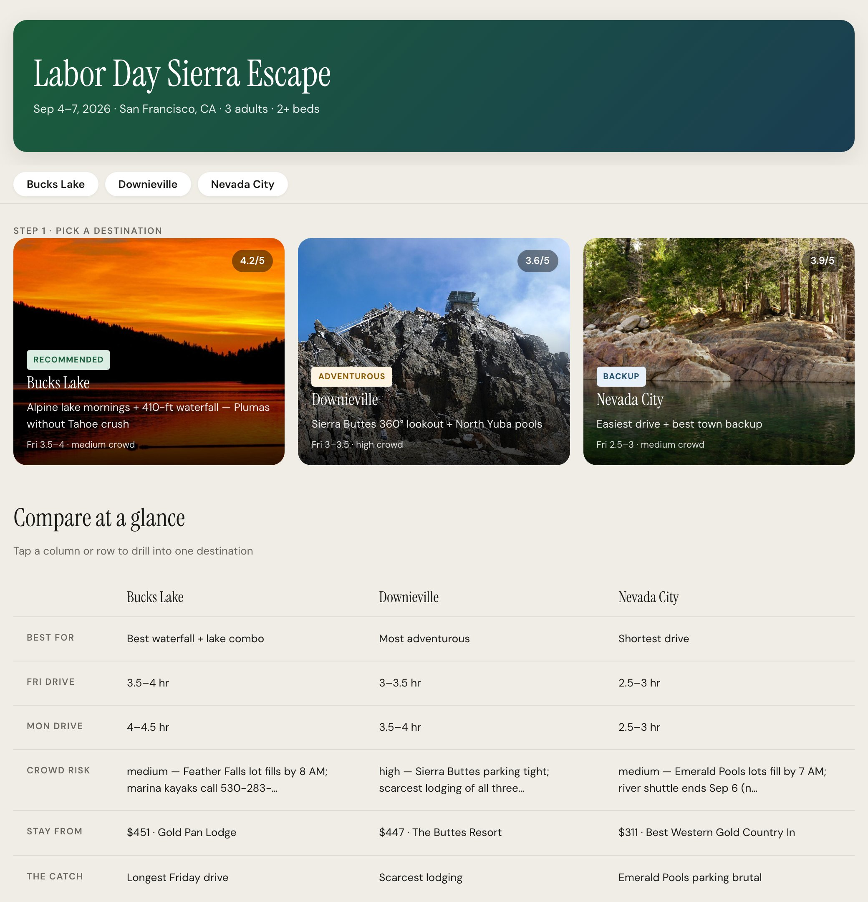
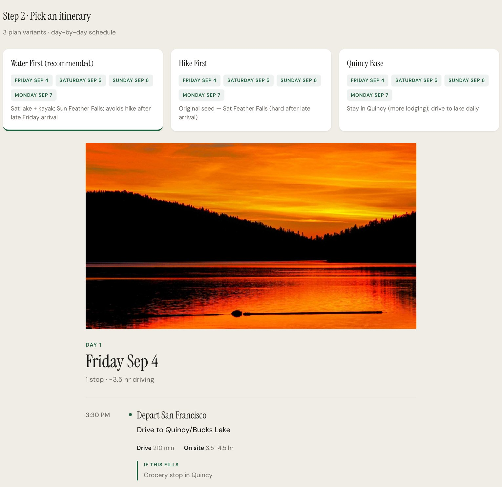

<div align="center">

<h1>travel-agent</h1>

<p><b>An agent skill that plans trips as options.</b></p>

<p><i>A group can't vote on one fixed itinerary. This gives them two to five real destinations, three weekend plans each, on one page.</i></p>

<h6>


</h6>

<a href="#how-it-works"><b>How it works</b></a> ·
<a href="#the-trip-explorer-page"><b>The page</b></a> ·
<a href="#run-it"><b>Run it</b></a> ·
<a href="#reference"><b>Reference</b></a>

<br><br>



<sub>A real three-option Labor Day trip, re-rendered locally with the starting city changed to San Francisco.</sub>

</div>

<br>

## The problem

Planning a weekend for a group usually ends in one of two ways: someone sends a single itinerary
nobody chose, or a chat thread fills with links nobody compares. travel-agent is a set of
instructions and scripts for a coding agent (Cursor or Hermes). It researches several
destinations in parallel, checks lodging against the group's bed count, and renders everything
into one page the group can read in under 15 minutes. It links to booking sites; it never books.

## How it works

<table>
<tr>
<td width="33%" valign="top">

**1 · Confirm the trip**

The agent echoes a one-paragraph spec back first: depart and return times, origin, travelers
and beds, two to five destination seeds. No research starts until you approve it.

</td>
<td width="33%" valign="top">

**2 · Research in parallel**

One subagent per destination (up to five at once) gathers access, four or more lodgings, real
reviews, three day plans and 1 to 5 scores, using Printing Press travel CLIs.

</td>
<td width="33%" valign="top">

**3 · Render and share**

The results merge into `trip-explorer.json`, which is validated, rendered to a single HTML page,
turned into a TripKit map for the top pick and published to Cloudflare Pages.

</td>
</tr>
</table>

## The trip explorer page

<div align="center">



<sub>After picking a destination: three plan variants and the day-by-day schedule. Same trip as above.</sub>

</div>

- **Pick a destination, then a plan.** Cards with score and badge (recommended, adventurous, backup), then three itineraries per destination with a timed schedule for each day.
- **Compare at a glance.** One table across destinations: best for, Friday and Monday drive, crowd risk, cheapest stay and "the catch".
- **A fallback for every stop.** Each schedule block carries drive minutes, time on site, parking advice and an "if this fills" alternative.
- **Lodging checked against the group.** Four or more stays per destination with bed fit, price, availability and a booking link.
- **Map, reviews and a pre-trip list.** A Leaflet map on OpenStreetMap tiles, cited reviews (never invented quotes), and parking targets, reservations and things to verify 48 hours out.
- **A group message.** A short summary under 180 words, ready to paste into a group chat.
- **One self-contained file.** The JSON is inlined into `index.html`, so the page re-renders from data and deploys anywhere.

## Run it

Needs Node.js. Install the skill where your agent looks for skills, then ask it to plan a trip:

```bash
git clone https://github.com/parthchandak02/travel-agent.git
cp -r travel-agent ~/.cursor/skills/travel-agent            # or ~/.hermes/skills/travel/travel-agent
bash travel-agent/scripts/install-deps.sh                    # TripKit and Windward
```

Once a trip folder has a `trip-explorer.json`, one command does the rest:

```bash
bash scripts/run-trip.sh path/to/my-trip/ --no-publish   # validate, render index.html, TripKit map
node scripts/validate-trip-explorer.js path/to/my-trip/trip-explorer.json
```

Without `--no-publish` it deploys through the owner's own Cloudflare Pages script, which is not in
this repo. The research step relies on separately installed Printing Press CLIs; only the
TripAdvisor one needs an API key.

## Reference

<details>
<summary><b>Project layout</b></summary>

```
SKILL.md                              Orchestrator instructions and the CLI recipes
GOAL.md                               Product north star and success criteria
assets/trip-explorer-template.html    The page; trip JSON is injected at render time
references/
  intake-gate.md                      Phase 0: confirm the spec before research
  parallel-research-protocol.md       Subagent split and prompt template
  trip-explorer-schema.md             The JSON contract, scores and status enums
  trip-explorer-design.md             Page design notes
  tripkit-bridge.md                   Converting a chosen plan to TripKit YAML
  printing-press-tools.md             Which travel CLI to use in which phase
  competitive-landscape.md            Other trip planners and how they compare
scripts/
  run-trip.sh                         validate, render, map, publish
  validate-trip-explorer.js           Errors on fewer than 2 options, 4 lodgings or 3 activities
  render-trip-explorer.js             JSON into the HTML template
  json-to-tripkit.js                  Chosen option and plan into TripKit YAML
  publish-trip-explorer.sh            Render and deploy
  install-deps.sh                     TripKit and Windward
```

</details>

<details>
<summary><b>Which tool for which question</b></summary>

| Situation | Tool |
|---|---|
| Two to five specific destination ideas | trip explorer (this skill) with parallel subagents |
| "Somewhere under $X, anywhere" | Windward, for priced flight and hotel options |
| One destination chosen, wants a map | TripKit |

</details>

<br>

<div align="center">
<sub>Built with Node.js, Leaflet and TripKit. Research through Printing Press travel CLIs. Apache 2.0.</sub>
</div>
